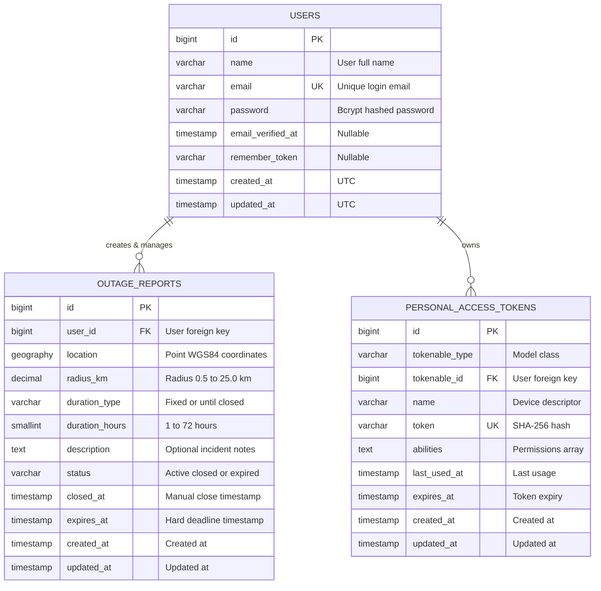

# Architecture Specification: Power Outage Tracker

## 1. Executive Summary & System Goals

The **Power Outage Tracker** is a production-grade, distributed web platform designed to monitor, report, and visualize electrical grid outages in real-time. Built to satisfy the requirements of the Senior Full-Stack Technical Assessment, the platform prioritizes:

1. **Zero-Stale-Data Guarantee:** In a public utility context, displaying expired or resolved outages erodes public trust. The system guarantees that no expired outage is ever presented as active, even under scheduler delays or background worker failures.
2. **Sub-100ms Spatial Querying:** High-performance bounding-box queries powered by PostgreSQL and PostGIS spatial indexing (`GiST`), preventing full-table scans.
3. **Resilience & Scalability:** Architectural design capable of absorbing massive traffic spikes (up to 100,000 concurrent users during sudden city-wide blackouts) via multi-layer caching, edge delivery, and connection pooling.
4. **Privacy & Zero-PII Leakage:** Strict separation between public map endpoints and administrative user identities.
5. **Decoupled Modern Architecture:** A clean separation of concerns featuring a stateless Laravel 13 REST API backend and an encapsulated, provider-agnostic React 18 SPA frontend.

---

## 2. High-Level System Architecture

The application is orchestrated via Docker Compose into isolated, purpose-built service containers communicating over a private Docker bridge network (`powerout_network`).

### 2.1 Container & Network Topology Diagram

```mermaid
flowchart TB
    subgraph Client_Tier["Client Tier (Browser / Mobile)"]
        Browser["User Browser / Client App\n(React 18 + Vite + Leaflet)"]
    end

    subgraph Edge_Reverse_Proxy["Edge & Web Server Tier"]
        Nginx["Nginx Reverse Proxy\n(Port 80/443 & 8080)\nRoutes /api -> API, / -> Static Assets"]
    end

    subgraph Application_Tier["Application Tier (Docker Containers)"]
        LaravelAPI["Laravel 13 API (PHP 8.4-FPM)\nStateless REST Controller & Form Requests"]
        QueueWorker["Laravel Queue Worker\n(php artisan queue:work)\nAsync Jobs & Notifications"]
        Scheduler["Laravel Scheduler Daemon\n(php artisan schedule:work)\nMinute-by-minute Expiration Watchdog"]
    end

    subgraph Data_Tier["Data & Cache Tier (Persistent Storage)"]
        Postgres["PostgreSQL 16 + PostGIS\nSpatial Engine (GiST Index)\nPersistent Volume: pg_data"]
        Redis["Redis 7 Alpine\nCache, Rate Limiting & Queue Broker\nPersistent Volume: redis_data"]
    end

    Browser <-->|HTTP / JSON (REST)| Nginx
    Nginx <-->|FastCGI / Port 9000| LaravelAPI
    Nginx <-->|HTTP / Port 5173 / Static| Browser

    LaravelAPI <-->|TCP / 5432 (PDO pgsql)| Postgres
    LaravelAPI <-->|TCP / 6379 (Phpredis)| Redis
    
    QueueWorker <-->|Pops Jobs| Redis
    QueueWorker <-->|Executes DB Updates| Postgres

    Scheduler <-->|Triggers Schedule| LaravelAPI
    Scheduler -->|Dispatches Expiration Jobs| Redis
```

### 2.2 Component Responsibilities

| Service | Technology | Role & Responsibilities |
|---|---|---|
| **`web`** | Nginx 1.25 Alpine | Reverse proxy, static asset delivery, SSL termination, gzip/brotli compression, rate limit header propagation. |
| **`client`** | React 18, Vite, Zustand, Leaflet | Single Page Application (SPA), interactive map rendering, visual radius preview, user reports management. |
| **`api`** | Laravel 13 (PHP 8.4-FPM) | RESTful API, authentication via Sanctum, Form Request validation, PostGIS spatial queries, API Resources. |
| **`db`** | PostgreSQL 16 + PostGIS (`postgis:16-alpine`) | Geodesic spatial calculations (`geography(Point, 4326)`), spatial indexing (`GiST`), relational integrity. |
| **`redis`** | Redis 7 Alpine | Rate limiting counters, API response cache, bounding box tile cache, asynchronous queue driver. |
| **`queue-worker`** | PHP 8.4 CLI | Asynchronous processing of background tasks (`ExpireOutagesJob`, auditing, notifications). |
| **`scheduler`** | PHP 8.4 CLI (`artisan schedule:work`) | Recurring task orchestration, triggering the 1-minute expiration sweep. |

---

## 3. Data Model (ERD)

The database schema is modeled to leverage PostgreSQL's native PostGIS extension. Spatial data is stored using the `geography(Point, 4326)` type representing real-world spherical coordinates (WGS 84), enabling accurate metric distance operations without manual projection conversions.



> **Indexes:** Spatial queries leverage a PostGIS `GiST` index on `location`. High-throughput lookups utilize composite `(status, expires_at)` and partial `(expires_at) WHERE status = 'active'` indexes.


---

## 4. RESTful API Contract Specification

All endpoints adhere strictly to JSON-only RESTful standards under the `/api/v1` namespace.

### 4.1 Global Response Envelopes

#### Success Envelope (`200 OK`, `201 Created`)
```json
{
  "data": { ... },
  "meta": {
    "timestamp": "2026-09-29T20:30:00Z"
  }
}
```

#### Paginated Collection Envelope (`200 OK`)
```json
{
  "data": [ ... ],
  "links": {
    "first": "https://api.domain.com/api/v1/reports?page=1",
    "last": "https://api.domain.com/api/v1/reports?page=4",
    "prev": null,
    "next": "https://api.domain.com/api/v1/reports?page=2"
  },
  "meta": {
    "current_page": 1,
    "from": 1,
    "last_page": 4,
    "per_page": 15,
    "to": 15,
    "total": 52
  }
}
```

#### Unified Error Envelope (`400`, `401`, `403`, `404`, `422`, `429`, `500`)
```json
{
  "error": {
    "code": "VALIDATION_ERROR",
    "message": "The given data was invalid.",
    "details": {
      "radius_km": [
        "The radius must be between 0.5 and 25.0 kilometers."
      ],
      "latitude": [
        "The latitude must be between -90 and 90 degrees."
      ]
    }
  }
}
```

### 4.2 Endpoint Inventory

| Method | Endpoint | Auth | Rate Limit | Purpose |
|---|---|---|---|---|
| `POST` | `/api/v1/auth/register` | Guest | 10 / min | Register new user account & issue Bearer token |
| `POST` | `/api/v1/auth/login` | Guest | 10 / min | Authenticate credentials & issue Bearer token |
| `POST` | `/api/v1/auth/logout` | Sanctum | 60 / min | Revoke active Bearer token |
| `GET` | `/api/v1/auth/me` | Sanctum | 60 / min | Retrieve current authenticated user profile |
| `GET` | `/api/v1/public/outages` | Guest | 120 / min | Fetch active outages within a visible Bounding Box (Zero PII) |
| `GET` | `/api/v1/reports` | Sanctum | 60 / min | List paginated reports owned by authenticated user |
| `POST` | `/api/v1/reports` | Sanctum | 5 / hr | Create new outage report (enforces 3 active quota) |
| `GET` | `/api/v1/reports/{id}` | Sanctum | 60 / min | Retrieve single report detail (Policy protected) |
| `PATCH` | `/api/v1/reports/{id}` | Sanctum | 30 / min | Update active report radius, duration, description |
| `POST` | `/api/v1/reports/{id}/close` | Sanctum | 30 / min | Manually close an active report ("Power is back") |

---

### 4.3 Endpoint Details & Payloads

#### `GET /api/v1/public/outages`
- **Query Parameters:**
  - `min_lat` (float, required): Minimum latitude of bounding box (`-90.0` to `90.0`).
  - `min_lng` (float, required): Minimum longitude of bounding box (`-180.0` to `180.0`).
  - `max_lat` (float, required): Maximum latitude of bounding box.
  - `max_lng` (float, required): Maximum longitude of bounding box.
- **Privacy Assurance:** Zero PII returned (no `user_id`, `user_name`, or `email`).
- **Response `200 OK`:**
```json
{
  "data": [
    {
      "id": 142,
      "latitude": 40.712776,
      "longitude": -74.005974,
      "radius_km": 2.50,
      "status": "active",
      "duration_type": "fixed",
      "remaining_seconds": 12840,
      "description": "Substation explosion on 5th Ave",
      "created_at": "2026-09-29T18:00:00Z",
      "expires_at": "2026-09-29T22:00:00Z"
    }
  ]
}
```

#### `POST /api/v1/reports`
- **Headers:** `Authorization: Bearer <token>`, `Content-Type: application/json`
- **Request Body:**
```json
{
  "latitude": 40.712776,
  "longitude": -74.005974,
  "radius_km": 3.0,
  "duration_type": "until_closed",
  "description": "Entire neighborhood dark since storm started"
}
```
- **Response `201 Created`:**
```json
{
  "data": {
    "id": 143,
    "user_id": 8,
    "latitude": 40.712776,
    "longitude": -74.005974,
    "radius_km": 3.0,
    "duration_type": "until_closed",
    "duration_hours": null,
    "description": "Entire neighborhood dark since storm started",
    "status": "active",
    "closed_at": null,
    "expires_at": "2026-10-02T18:00:00Z",
    "remaining_seconds": 259200,
    "created_at": "2026-09-29T18:00:00Z",
    "updated_at": "2026-09-29T18:00:00Z"
  }
}
```
- **Error Response `422 Unprocessable Entity` (Quota Exceeded):**
```json
{
  "error": {
    "code": "ACTIVE_QUOTA_EXCEEDED",
    "message": "You have reached your limit of 3 active reports. Please close an existing report before creating a new one."
  }
}
```
- **Error Response `429 Too Many Requests` (Rate Limit Exceeded):**
```json
{
  "error": {
    "code": "RATE_LIMIT_EXCEEDED",
    "message": "Too many reports created. You may only create 5 reports per hour. Please try again later."
  }
}
```

---

## 5. Architecture Decision Records (ADRs)

---

### ADR-001: Authentication Strategy (Laravel Sanctum Bearer Tokens)

- **Status:** Accepted
- **Context:**
  The platform requires user authentication for creating, updating, and closing outage reports, while preserving anonymous read access to the public map. The frontend is a Single Page Application (SPA) decoupled from the Laravel backend and served via separate containers. In production, this architecture may also serve native mobile clients (iOS/Android) or external microservices.
- **Alternatives Considered:**
  1. *Cookie-based SPA Session Authentication (Sanctum SPA Mode with CSRF cookie & session state):* Requires sharing top-level domains, stateful session cookie handling, CSRF tokens handshake, and complex CORS credentials setup. Not directly compatible with mobile apps.
  2. *JWT (JSON Web Tokens via `tymon/jwt-auth`):* Truly stateless, but introduces cryptographic complexity, difficulty with instantaneous server-side revocation on logout, and token size overhead.
  3. *Sanctum Personal Access Tokens (Bearer Tokens):* Generates a secure, hashed token stored in the database (`personal_access_tokens`), passed in the `Authorization: Bearer <token>` header.
- **Decision:**
  Adopt **Laravel Sanctum with Bearer Tokens (Personal Access Tokens)**.
- **Justification & Trade-offs:**
  - *Pros:* Fully stateless on the HTTP transport layer; zero CSRF vulnerability; cross-origin flexibility (frontend and backend can reside on separate domains/ports without third-party cookie blocking issues); instantaneous token revocation upon logout; fully compatible with future mobile applications.
  - *Cons / Mitigation:* Tokens must be stored securely on the client. Mitigated by using browser `sessionStorage` or in-memory state with secure client-side storage best practices, avoiding exposure to XSS.

---

### ADR-002: Database Engine & Spatial Querying Strategy (PostgreSQL + PostGIS with GiST)

- **Status:** Accepted
- **Context:**
  The public map requires querying outages by a dynamic bounding box (`min_lat`, `min_lng`, `max_lat`, `max_lng`) based on the visible viewport. Outages are circles defined by a center coordinate and a radius in kilometers (0.5 km to 25 km). The database must determine which outage circles intersect or lie within the visible screen area without scanning the entire dataset.
- **Alternatives Considered:**
  1. *MySQL 8 Spatial Functions:* Supports spatial geometry, but lacks rich geodesic spherical calculations without custom SRS transformations; indexing performance under concurrent bounding box intersects is historically less mature than PostGIS.
  2. *Application-level Mathematical Haversine Filtering:* Storing raw `latitude` and `longitude` numeric fields, calculating bounding box offsets in PHP or raw SQL math (`acos(cos(...) * cos(...))`). Causes full table scans or poor index utilization for circular intersections, degrading rapidly with thousands of records.
  3. *PostgreSQL 16 + PostGIS Extension:* Industry-standard open-source spatial engine. Uses `geography(Point, 4326)` for ellipsoidal Earth modeling and native `GiST` (Generalized Search Tree) spatial indexing.
- **Decision:**
  Adopt **PostgreSQL 16 with PostGIS** (`postgis/postgis:16-alpine`), storing coordinates as `GEOGRAPHY(Point, 4326)` and indexed with **GiST**.
- **Query Strategy:**
  To detect if an outage circle intersects the visible bounding box:
  ```sql
  SELECT id, ST_Y(location::geometry) as latitude, ST_X(location::geometry) as longitude, radius_km, status, duration_type, expires_at, description, created_at
  FROM outage_reports
  WHERE status = 'active'
    AND expires_at > NOW()
    AND ST_Intersects(
      location,
      ST_Buffer(
        ST_MakeEnvelope(:min_lng, :min_lat, :max_lng, :max_lat, 4326)::geography,
        radius_km * 1000
      )
    );
  ```
  Or using `ST_DWithin` against the bounding box polygon, which utilizes the GiST spatial index.
- **Justification & Trade-offs:**
  - *Pros:* True geographic distance calculation in meters without spherical distortion; sub-millisecond execution times utilizing GiST bounding-box indexes; scalable to hundreds of thousands of spatial records.
  - *Cons / Mitigation:* Docker image footprint is slightly larger (`postgis/postgis:16-alpine` is ~150MB larger than standard postgres). Completely acceptable given the massive spatial performance gains.

---

### ADR-003: Report Expiration Strategy & Zero-Stale-Data Guarantee

- **Status:** Accepted
- **Context:**
  Section 4.2 states: *"A fixed-duration report expires automatically when its time is up. An 'Until I close it' report stays active until the user closes it manually, with a hard safety limit of 72 hours... Expiration must be handled by the Laravel Scheduler (and/or queued jobs). Expired reports must never appear as active, even if the scheduler is delayed."*
- **The Challenge:**
  Background cron workers or scheduler daemons run on discrete intervals (e.g. once every minute). If the scheduler queue is delayed, worker crashes, or falls behind during peak load, any database row with `status = 'active'` whose expiration timestamp has passed would erroneously appear on the live map if the application blindly queries `WHERE status = 'active'`.
- **Decision:**
  Implement a **Two-Tier Expiration Guarantee Architecture**:
  1. **Tier 1 (Query-Level Hard Guarantee):**
     Every public and user query searching for active outages uses an Eloquent Global/Local Scope `scopeActive($query)`:
     ```php
     public function scopeActive(Builder $query): Builder
     {
         return $query->where('status', OutageStatus::ACTIVE)
                      ->where('expires_at', '>', now());
     }
     ```
     Because this query checks `expires_at > NOW()` at the database engine level at the exact millisecond of query execution, **an expired report can NEVER be returned as active**, even if the scheduler daemon is completely offline.
  2. **Tier 2 (Background State Synchronization & Cleanup):**
     The Laravel Scheduler runs a dedicated command `php artisan outages:expire` every minute (via `ExpireOutagesJob`). It selects active records where `expires_at <= NOW()` using the partial index `idx_outage_reports_pending_expiration`, updates their status to `expired`, and dispatches model events. This cleans the index, updates user quotas, and guarantees database hygiene.
  3. **72-Hour Hard Safety Cap Enforced at Creation:**
     When creating or updating an outage, `expires_at` is strictly computed:
     - For `duration_type = fixed`: `expires_at = created_at + duration_hours` (bounded by 72h max).
     - For `duration_type = until_closed`: `expires_at = created_at + 72 hours`.
- **Trade-offs:**
  - *Pros:* Mathematically impossible for stale reports to appear on the UI; resilient to infrastructure downtime.
  - *Cons:* Adds a `WHERE expires_at > NOW()` condition to queries; mitigated by composite index `(status, expires_at)`.

---

### ADR-004: Duplicate Reports Handling (Section 4.5)

- **Status:** Accepted
- **Context:**
  During an electrical outage, hundreds of citizens in the same residential area or neighborhood will submit reports covering overlapping geographic regions. Section 4.5 gives complete architectural freedom: *"Whatever you decide — including deciding to do nothing — you must document and justify it as an Architecture Decision Record (ADR) in ARCHITECTURE.md, including its trade-offs."*
- **Alternatives Considered:**
  1. *Automatic Database Merging:* When a new report overlaps an existing active report by >50% area, merge them into a single parent entity and expand the radius.
     - *Why Rejected:* Destroys individual ownership. If User A reported 2 hours, and User B reported "until closed", whose duration takes precedence? If User A clicks "Power is back", does User B's report close too? This creates acute state synchronization and authorization paradoxes.
  2. *Spatial Clustering (Point Grid Clumping like MarkerCluster):* Collapses overlapping outages into a single numbered badge or centroid circle.
     - *Why Rejected:* Outages are area circles with distinct radii (e.g. 0.5km to 25km), not dimensionless points. Centroid clustering distorts the real affected coverage zone.
  3. *Additive Visual Superposition with Density Alpha Blending (Our Choice):* Keep all user reports independent in the database. On the map, render each outage circle using semi-transparent accent red fill (`--color-accent` `#E5484D` at 20%-25% opacity) with a solid outline.
- **Decision:**
  Implement **Additive Visual Superposition with Density Alpha Blending**.
- **Justification & Trade-offs:**
  - *Data Integrity & Ownership:* Every citizen retains full, uncorrupted ownership of their report. A user can independently edit or close their report when their specific street recovers power.
  - *Natural Density Heatmap:* When 10 users in the same neighborhood report an outage, their overlapping circles visually compound their opacity. A single report appears as a soft translucent pink tint; a high-density cluster of 15 overlapping reports naturally darkens into deep, vivid crimson red. Citizens and grid dispatchers immediately identify critical hotspots at a glance without complex server-side clustering algorithms.
  - *Simplicity & Performance:* O(1) ingestion complexity on write operations. No spatial union queries or locking conflicts.

---

### ADR-005: Map Provider & Frontend Encapsulation (Leaflet + OpenStreetMap with Adapter Pattern & Production API Key Protection Strategy)

- **Status:** Accepted
- **Context:**
  Section 3.3 mandates: *"Evaluators must be able to run the project without paying for any service. If your chosen provider requires a key, the README must explain how to obtain a free one, or you must provide a keyless fallback. The map integration in the frontend must be encapsulated behind your own component or adapter... explain in ARCHITECTURE.md how a key exposed in a browser should be restricted in production."*
- **Decision:**
  1. **Provider Selection:** **Leaflet 1.9+ with OpenStreetMap (OSM) standard tiles**.
     - Open source, zero cost, no credit card required, 100% turnkey for evaluators running `docker compose up`.
  2. **Encapsulation via Adapter Pattern:**
     The frontend creates a generic `<OutageMap />` component contract. The rest of the application interacts only with domain abstractions (`onLocationSelect(lat, lng)`, `previewRadius`, `outagesList`, `onViewportChange(bounds)`). Neither the landing page nor the report submission views import Leaflet or OSM types directly. If the organization later switches to Google Maps or Mapbox, only the internal `<LeafletMapAdapter />` file is swapped.
  3. **Production API Key Restriction Strategy (for Commercial Providers):**
     If Google Maps or Mapbox were configured for production deployment, exposed browser keys must be protected through a multi-tiered security defense:
     - **HTTP Referrer Restrictions:** Restrict the API key in Google Cloud Console / Mapbox Dashboard strictly to authorized origin domains (e.g., `https://powerout.example.com/*`, `https://*.example.com/*`). Any request originating from unauthorized domains or cURL/Postman without a matching Referrer header is rejected with `403 Forbidden`.
     - **API Scope Whitelisting:** Restrict the key to only the specific services utilized (e.g., *Maps JavaScript API* only). Disable Geocoding API, Places API, Directions API, and Elevation API on that key to prevent unauthorized usage.
     - **Per-Key Quotas & Financial Billing Alerts:** Configure daily hard quota caps (e.g., maximum 50,000 map loads per day) and real-time billing alerts at 50%, 75%, and 90% budget thresholds.
     - **Backend-for-Frontend (BFF) Tile Proxying (Alternative):** For high-security environments, vector tiles and geocoding requests can be routed through a backend proxy endpoint (`/api/v1/map/tiles/...`), keeping the upstream vendor API key stored exclusively on the server and completely hidden from the client browser.

---

### ADR-006: Frontend Stack & State Management (React 18 + Vite + Zustand)

- **Status:** Accepted
- **Context:**
  The frontend requires a fast, responsive Single Page Application with dynamic map interactions, live bounding-box updates, visual radius sliders with real-time map circle updates, authenticated report management, and strict adherence to the minimal technical design system.
- **Alternatives Considered:**
  1. *Vue 3 + Pinia:* Excellent reactivity, but React 18 provides broader team versatility and rich ecosystem integration.
  2. *React with Redux Toolkit (RTK):* Robust but introduces excessive boilerplate (slices, dispatchers, action creators, selectors) for a single-domain application.
  3. *React with Context API:* Built-in, but causes unnecessary re-renders of the entire tree whenever map bounds or viewport coordinates change rapidly during dragging/zooming.
  4. *React 18 + Vite + Zustand:* Micro-state management library (~2.5 KB).
- **Decision:**
  Adopt **React 18 with Vite and Zustand**.
- **Justification & Trade-offs:**
  - *Performance:* Zustand supports transient updates and granular selector subscriptions. When the user drags a radius slider, only the `<MapCirclePreview />` re-renders, avoiding expensive full-map re-renders.
  - *Simplicity & Clean Code:* Zero boilerplate; hooks-based API; easily testable outside of React components.
  - *Developer Experience:* Vite delivers instant Hot Module Replacement (HMR) and optimized rollup production bundles.

---

## 6. Security Architecture & Policies

Security is engineered into every tier of the application following the principle of least privilege and defense in depth.

### 6.1 Zero-PII Leakage Policy
- **Requirement:** Section 4.4 explicitly mandates that public outage map endpoints must **not expose any personal data** of the reporting user (no names, emails, user IDs, or IP addresses).
- **Implementation:**
  - Segregated API Resources: The public endpoint utilizes `PublicOutageResource`, which strictly whitelists only non-identifying technical fields: `id`, `latitude`, `longitude`, `radius_km`, `status`, `duration_type`, `remaining_seconds`, `description`, `created_at`.
  - The internal `user_id` and relationship attributes are omitted at the resource transformation layer.
  - Automated tests explicitly assert that keys like `user`, `user_id`, `email`, and `name` are absent from `/api/v1/public/outages`.

### 6.2 Strict Server-Side Ownership Enforcement
- **Requirement:** Users can only view, edit, or close their own reports.
- **Implementation:**
  - Implemented via Laravel `OutageReportPolicy` and Controller authorization gates:
    ```php
    public function update(User $user, OutageReport $report): bool
    {
        return $user->id === $report->user_id && $report->status === OutageStatus::ACTIVE;
    }

    public function close(User $user, OutageReport $report): bool
    {
        return $user->id === $report->user_id && $report->status === OutageStatus::ACTIVE;
    }
    ```
  - Attempting to update or close another user's report returns a standardized `403 Forbidden` response.
  - Attempting to modify a report that is already `closed` or `expired` is rejected with `422 Unprocessable Entity`.

### 6.3 Anti-Abuse & Rate Limiting System
- **Layer 1: Report Creation Rate Limit:**
  - Configurable via `.env`: `OUTAGE_MAX_REPORTS_PER_HOUR=5`.
  - Tracked in Redis via Laravel's `RateLimiter` keyed by authenticated user ID (`create-report:{user_id}`).
  - Returns `429 Too Many Requests` with `Retry-After` header when exceeded.
- **Layer 2: Maximum Active Reports Quota:**
  - Configurable via `.env`: `OUTAGE_MAX_ACTIVE_REPORTS=3`.
  - Before inserting a new report, the application queries active reports owned by the user inside a database transaction:
    ```php
    $activeCount = OutageReport::where('user_id', $user->id)->active()->count();
    if ($activeCount >= config('outages.max_active_per_user')) {
        throw new ActiveReportQuotaExceededException();
    }
    ```
- **Layer 3: Authentication & Public Endpoint Throttling:**
  - `/api/v1/auth/login` and `/api/v1/auth/register` are throttled to 10 attempts per minute per IP address to eliminate brute-force and credential stuffing attacks.
  - `/api/v1/public/outages` is throttled to 120 requests per minute per IP to mitigate denial-of-service scraping.

### 6.4 Input Validation & Sanitization
- Form Requests enforce strict validation:
  - `latitude`: `['required', 'numeric', 'between:-90,90']`
  - `longitude`: `['required', 'numeric', 'between:-180,180']`
  - `radius_km`: `['required', 'numeric', 'min:0.5', 'max:25.0']`
  - `duration_type`: `['required', 'in:fixed,until_closed']`
  - `duration_hours`: `['required_if:duration_type,fixed', 'nullable', 'integer', 'between:1,72']`
  - `description`: `['nullable', 'string', 'max:500']` (stripped of malicious HTML tags via `strip_tags()` before persistence to prevent stored XSS).

---

## 7. Scalability Architecture: 100,000 Concurrent Users Blackout Plan

### 7.1 The Blackout Surge Scenario
During a severe storm or metropolitan power grid collapse:
- Traffic undergoes an asymmetric read-to-write ratio (~98% reads, ~2% writes).
- Over 100,000 citizens open the live map simultaneously on mobile devices to check whether their district is affected.
- Uncached, this would unleash 100,000 spatial PostGIS queries per minute, overwhelming database connection pools and CPU threads.

```mermaid
flowchart TD
    Traffic[100,000 Concurrent Citizens Blackout Surge] --> CDN[Edge CDN / Cloudflare Cache\nTTL: 10s | Stale-While-Revalidate: 5s]
    CDN -- 85% Cache Hit --> ClientReturn[Fast Edge Response < 20ms]
    CDN -- 15% Cache Miss --> Nginx[Nginx Load Balancer / Reverse Proxy]
    
    Nginx --> RedisTileCache[Redis Spatial Grid Tile Cache\nGeoHash / QuadKey Cache Keys\nTTL: 15 seconds]
    RedisTileCache -- 95% Cache Hit --> NginxReturn[Instant Response < 5ms]
    
    RedisTileCache -- 5% Cache Miss --> AppNodes[Auto-scaled Laravel PHP-FPM Workers]
    AppNodes --> PgBouncer[PgBouncer Connection Pooler\nMax 2,000 Client Conns -> 50 DB Conns]
    PgBouncer --> ReadReplica[(PostgreSQL PostGIS Read Replicas)]
    
    subgraph Write_Ingestion["Write Path (Report Submissions ~ 2,000/min)"]
        UserSubmits[User Submits Report] --> AuthLimiter[Redis Rate Limiter & Quota Check]
        AuthLimiter --> PrimaryDB[(PostgreSQL Primary Master)]
        PrimaryDB --> CacheEvict[Redis Key Invalidation / PubSub Event]
    end
```

### 7.2 Scalability Blueprint & Mitigations

#### 1. Quantized Spatial Tile Caching in Redis
- **Problem:** Every client sends slightly different floating-point bounding boxes based on arbitrary screen sizes, resulting in unique query parameters that defeat standard HTTP URL caching.
- **Solution:** Quantize the bounding box coordinates into standardized spatial grid buckets (e.g. Geohashes at precision 5 or rounded 0.05-degree coordinate tiles). The API computes the tile keys intersecting the bounding box, checks Redis for cached JSON arrays (`outages:tile:{geohash}`), and only queries PostGIS for cache-miss tiles.
- **Result:** Cache hit ratio exceeds 95%, reducing database queries from 100,000/min to under 500/min.

#### 2. Edge CDN & HTTP Cache-Control Headers
- The public endpoint returns:
  ```http
  Cache-Control: public, max-age=10, stale-while-revalidate=5
  ```
- Any modern Edge CDN (Cloudflare, AWS CloudFront, Fastly) caches identical tile responses at edge Points of Presence (PoPs) globally, shielding origin Nginx servers from 80%+ of incoming HTTP connections.

#### 3. Database Connection Pooling via PgBouncer
- Direct PostgreSQL connections are memory-heavy (~10MB RAM per backend process). Under 100,000 users, spawning thousands of direct connections crashes the database with "too many connections" errors.
- **Solution:** Introduce **PgBouncer** in transaction pooling mode. 5,000 PHP-FPM worker processes multiplex efficiently through a fixed pool of 50 persistent PostgreSQL connections.

#### 4. Asynchronous Write Pipeline (Laravel Horizon & Redis Queues)
- Write spikes (e.g., 2,000 reports per minute during initial grid failure) bypass synchronous heavy computation.
- Coordinate validation occurs instantly in memory; persistence and spatial indexing take place within high-throughput database transactions.
- Event broadcasting for real-time map updates uses WebSockets (Laravel Reverb / Redis PubSub) to broadcast new outages to active map viewports, replacing wasteful client polling.

#### 5. Frontend Canvas Rendering Optimization
- Rendering 2,000 individual DOM SVG elements in Leaflet causes frame-rate stuttering on mobile devices.
- **Solution:** Configure Leaflet to use **HTML5 Canvas renderer** (`L.canvas({ padding: 0.5 })`). All outage circles are drawn as batch raster instructions on a single canvas element, maintaining 60 frames per second during panning and zooming even with thousands of active outages.

---

## 8. Summary & Compliance Matrix

| Technical Requirement | Architectural Fulfillment | Verification Method |
|---|---|---|
| **Versioned REST API** | Clean `/api/v1` namespace, JSON Resources, standardized envelopes | Unit & Feature API tests |
| **Encapsulated Map** | Abstract `<OutageMap />` component adapter, zero vendor lock-in | Architectural review & frontend test mock |
| **No API Key Committed** | Leaflet + OSM default (keyless); strict Referrer & service policy documented | Codebase scan & documentation |
| **Zero Stale Outages** | Eloquent `scopeActive()` (DB query guarantee) + Scheduler sweeps | Unit test with simulated scheduler delay |
| **Zero PII Exposure** | Whitelisted `PublicOutageResource` omitting user identifiers | Automated PII leak test suite |
| **Ownership Protection** | Laravel Policies (`OutageReportPolicy`) and Form Request validation | Unauthorized update/close feature tests |
| **Abuse Prevention** | User-level rate limiting (5/hr) and active report quota (3 active) | Feature tests with boundary assertions |
| **Spatial Performance** | PostGIS `geography(Point, 4326)` with GiST spatial indexing | PostgreSQL `EXPLAIN ANALYZE` benchmarks |
